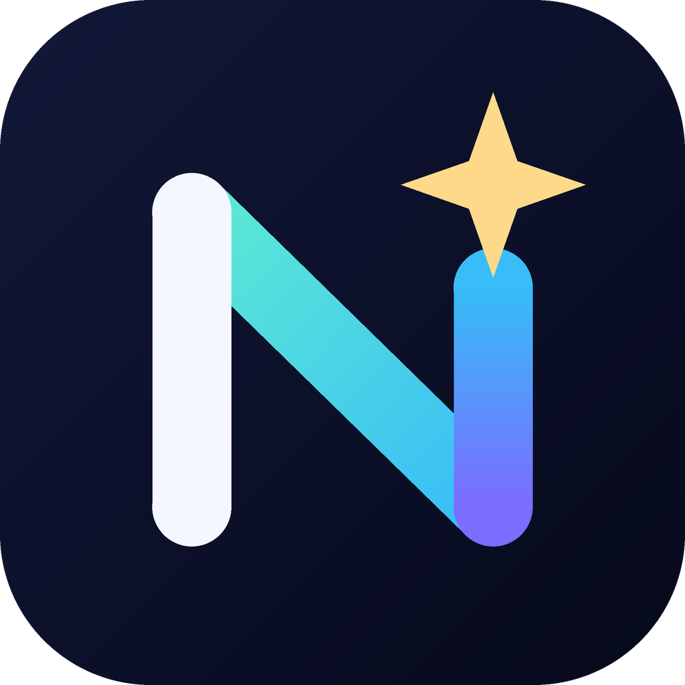

<p align="center">
  
</p>

<h1 align="center">Novara</h1>

<p align="center">
  A native Minecraft: Java Edition 26.3 client and launcher for Android, written in Rust.
</p>

<p align="center">
  <a href="https://github.com/GoyDevv/Horizon-Android/releases">Releases</a> ·
  <a href="docs/android.md">Documentation</a> ·
  <a href="CONTRIBUTING_ANDROID.md">Contributing</a> ·
  <a href="https://github.com/GoyDevv/Horizon-Android/issues">Issues</a>
</p>

---

Novara runs the game itself instead of wrapping a Java runtime. Rendering goes through
`wgpu` (Vulkan, with an OpenGL ES fallback), so it starts quickly and works on phones
that struggle with Java-based launchers. It is built on the Horizon engine and keeps
its upstream history.

| | |
| --- | --- |
| Android | 9+ (API 28–35) on 64-bit; 8.1 for the experimental 32-bit builds |
| Graphics | Vulkan 1.0+ or OpenGL ES 3.0 |
| Game | Minecraft Java Edition 26.3, single player and Java multiplayer |

## Install

1. Download the APK that matches your device from the [Releases](https://github.com/GoyDevv/Horizon-Android/releases) page (`arm64-v8a` for most phones).
2. Open the APK and allow installation from your browser or file manager if Android asks.
3. Start Novara and tap **Download Minecraft 26.3**. The first download is about 500 MiB and is verified against Mojang's published hashes.
4. Tap **Play**.

Updates are offered inside the app. They are installed over the existing app, so worlds
and settings stay in place as long as the same signing key is used.

## Features

- **Touch controls** – four schemes (joystick or D-pad with crosshair or tap aiming), a layout editor for position, size and opacity, and support for keyboards, mice and gamepads.
- **Rendering options** – Vulkan or GLES, resolution scale from 25% to 100%, battery saver mode and uncapped frame rate.
- **Accounts and skins** – Microsoft and Ely.by sign-in, offline names, a local skin and cape gallery with a 3D preview.
- **Content** – resource packs, shader packs and native `.hmod` packages, with checksum verification. Profiles keep separate saves and settings.
- **Files** – a built-in file manager, folder import and zip export, and a document provider so other file apps can reach your game folder.
- **Fabric installer** – installs Fabric Loader and a matching Fabric API for any Minecraft version Fabric supports (see below).

## Fabric installer

Open **Fabric**, below **Skins** in the side menu.

1. Pick a Minecraft version. Snapshots are hidden until you switch them on.
2. Pick one of the Fabric Loader versions offered for it.
3. Tap **Install Fabric**.

Novara downloads the loader profile and its libraries from Fabric's servers into the
active profile (`versions/` and `libraries/`), then finds the newest Fabric API build for
that Minecraft version on Modrinth and saves it in the profile's `mods/` folder.
Downloads show progress, files are checked against their published hashes, and
anything already downloaded is reused. Failures such as no connection, a full disk or a
Minecraft version without a Fabric API build are reported on the page.

Novara's engine does not run Java, so Fabric mods cannot be loaded by the game yet.
The installer prepares the files; running them needs a Java-based runtime or native ports
of the mods. See [Android feature support](docs/android-features.md).

## Building from source

Requirements: Android SDK (API 35, build-tools 35.0.0+), NDK r28+, Rust 1.90+ with the
`aarch64-linux-android` and `armv7-linux-androideabi` targets, JDK 17 or 21, Python 3.10+.

```sh
python3 tools/android_build.py --abi arm64-v8a --profile release
```

The APK is written to `packaging/android/build/outputs/apk/`. Details are in
[docs/android.md](docs/android.md). Before opening a pull request:

```sh
python3 -m unittest discover -s tests -p 'test_android*.py'
python3 tools/check_public_tree.py
```

The icon set is generated by `python3 tools/render_icon.py`.

## License

Code is released under the [MIT License](LICENSE). Minecraft is a trademark of Mojang
Synergies AB; this project is not affiliated with Mojang or Microsoft. The repository
contains no Minecraft assets, JARs or binaries.
